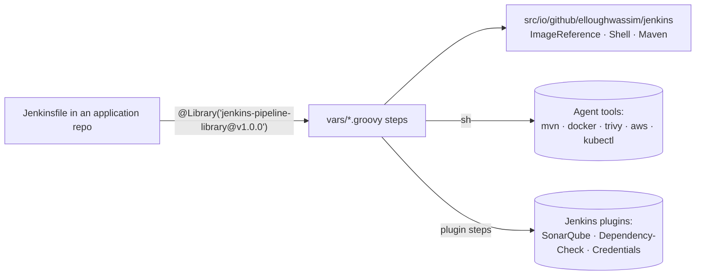

# Jenkins Pipeline Library

[](https://github.com/ElloughWassim/jenkins-pipeline-library/actions/workflows/ci.yml)
[](LICENSE)

A reusable [Jenkins Shared Library](https://www.jenkins.io/doc/book/pipeline/shared-libraries/) for Java/Maven
and container delivery pipelines. It covers build, test, SonarQube quality gates, OWASP Dependency-Check,
Trivy scanning, Docker Hub / Amazon ECR publishing and Kubernetes deployment.

## Overview

Pipelines often copy the same 200 lines of shell between projects. This library turns those stages into small,
validated, tested steps, so a `Jenkinsfile` describes *what* happens and the library decides *how*:

```groovy
@Library('jenkins-pipeline-library@v1.0.0') _

stage('Quality gate') { steps { sonarQubeQualityGate() } }
stage('Image scan')   { steps { trivyScan(type: 'image', target: image.primaryReference) } }
```

## Main features

- **One image model for two registries:** Docker Hub and Amazon ECR, selected by a single `registry` key.
- **Immutable image tags:** `<build number>-<git sha>`, with `latest` only as an extra tag.
- **Security gates that really gate:** Trivy and the SonarQube Quality Gate fail the build by default.
  Reports are always archived.
- **Safe shell usage:** every value placed in `sh` is validated or quoted. Registry passwords go through
  `--password-stdin` and are never interpolated by Groovy.
- **Reproducible Maven:** batch mode, no download progress, Maven Wrapper auto-detection.
- **Safe deployments:** `kubernetesDeploy` renders the image into a temporary copy of the manifests, waits for the rollout and undoes it on failure.
- **Tested:** a self-contained test suite runs every step against a mocked pipeline context in CI.

## Technologies and tools

Jenkins Pipeline (Groovy) · Maven · SonarQube · OWASP Dependency-Check · Trivy · Docker · Amazon ECR · Kubernetes ·
GitHub Actions · CodeNarc (npm-groovy-lint) · Gitleaks

## Architecture overview



`vars/` holds the public steps (the API). `src/` holds pure helper classes with the validation logic, which
can be tested without Jenkins.

## Repository structure

```
.
├── vars/                         # Global pipeline steps (public API)
│   ├── gitCheckout.groovy
│   ├── mavenBuild.groovy  mavenUnitTest.groovy  mavenIntegrationTest.groovy
│   ├── sonarQubeAnalysis.groovy  sonarQubeQualityGate.groovy
│   ├── owaspDependencyCheck.groovy  trivyScan.groovy
│   ├── imageTags.groovy  dockerBuild.groovy  dockerPush.groovy  dockerCleanup.groovy
│   └── kubernetesDeploy.groovy
├── src/io/github/elloughwassim/jenkins/
│   ├── ImageReference.groovy     # Docker Hub / ECR reference + validation
│   ├── Maven.groovy              # Maven command builder
│   └── Shell.groovy              # Quoting and input validation
├── test/run-tests.groovy         # Self-contained test suite (mocked pipeline)
├── examples/Jenkinsfile.maven-docker-k8s
└── .github/workflows/ci.yml      # Lint + tests + secret scan
```

## Prerequisites

| Component | Requirement |
|---|---|
| Jenkins | 2.4xx LTS or newer with **Pipeline**, **Git**, **Credentials Binding** |
| Optional plugins | **SonarQube Scanner**, **OWASP Dependency-Check**, **Pipeline: AWS Steps** / **AWS Credentials** (ECR), **JUnit** |
| Agent tools | `git`, `docker`, `trivy`, and as needed `mvn`/JDK, `aws` CLI v2, `kubectl` |

## Installation (register the library in Jenkins)

1. **Manage Jenkins → System → Global Trusted Pipeline Libraries → Add**
2. Name: `jenkins-pipeline-library`
3. Default version: `v1.0.0` (a tag; pin a tag instead of `main` for reproducible builds)
4. Retrieval method: **Modern SCM → Git**, project repository
   `https://github.com/ElloughWassim/jenkins-pipeline-library.git`

Register it as a *trusted* global library. The helper classes use standard Groovy methods that a
sandboxed folder-level library could require script approvals for.

## Configuration

### Jenkins credentials used by the steps

| Credential id (your choice) | Kind | Used by |
|---|---|---|
| `dockerhub-credentials` | Username with password (password = Docker Hub access token) | `dockerPush` (Docker Hub) |
| `aws-credentials` | AWS Credentials (or use an instance/IRSA role instead) | `dockerPush` (ECR) |
| `kubeconfig` | Secret file | `kubernetesDeploy` |
| `nvd-api-key` | Secret text | `owaspDependencyCheck` |
| SonarQube token | Secret text, referenced by the SonarQube server configuration | `sonarQubeAnalysis` |

### Image configuration map

```groovy
// Docker Hub
[registry: 'dockerhub', namespace: '<DOCKERHUB_NAMESPACE>', name: 'my-app', tags: imageTags()]
// Amazon ECR
[registry: 'ecr', awsAccountId: '<AWS_ACCOUNT_ID>', awsRegion: '<AWS_REGION>', name: 'my-app', tags: imageTags()]
```

### Step reference

| Step | Purpose | Key options (defaults) |
|---|---|---|
| `gitCheckout` | Clone a repository | `url`*, `branch` (`main`), `credentialsId` |
| `mavenBuild` | Package | `goals` (`clean package`), `skipTests` (`true`), `profiles`, `properties` |
| `mavenUnitTest` | `test` phase + JUnit report | `profiles`, `publishReports` (`true`) |
| `mavenIntegrationTest` | `verify` phase (Failsafe) | `skipUnitTestsProperty` (`skipUTs`), `profiles` |
| `sonarQubeAnalysis` | SonarQube scan | `installationName`*, `projectKey`, `scanner` (`maven`\|`cli`) |
| `sonarQubeQualityGate` | Wait for the gate | `timeoutMinutes` (`10`), `abortPipeline` (`true`) |
| `owaspDependencyCheck` | Dependency CVE scan | `odcInstallation`*, `failOnCvss` (`7`), `nvdApiKeyCredentialsId` |
| `trivyScan` | Vulnerability/secret/IaC scan | `type` (`fs`\|`image`\|`config`\|`repo`), `target`*, `severity` (`HIGH,CRITICAL`), `failBuild` (`true`) |
| `imageTags` | Build tags | `version`, `extraTags` (`['latest']`) |
| `dockerBuild` | Build + tag | `image`*, `context` (`.`), `dockerfile`, `buildArgs` (a `null` value is read from the environment) |
| `dockerPush` | Login, push, logout | `image`*, `credentialsId` (Docker Hub), `awsCredentialsId` (ECR) |
| `dockerCleanup` | Remove local tags | `image`* |
| `kubernetesDeploy` | Render image, apply, rollout, rollback | `manifests`*, `namespace`*, `deployment`*, `image`*, `imagePlaceholder` (`IMAGE_PLACEHOLDER`), `kubeconfigCredentialsId` |

`*` = required. Options are meant to come from the `Jenkinsfile` (trusted code). Values coming from build
parameters are validated by the library before use.

## How to use it

See [`examples/Jenkinsfile.maven-docker-k8s`](examples/Jenkinsfile.maven-docker-k8s) for a complete pipeline.
Real consumers:

- [`springboot-terraform-eks`](https://github.com/ElloughWassim/springboot-terraform-eks): Spring Boot → ECR/Docker Hub → EKS
- [`jpetstore-kubernetes-deployment`](https://github.com/ElloughWassim/jpetstore-kubernetes-deployment): JPetStore → Docker → Kubernetes

## How to run the tests

The suite needs only Java 17+ and a Groovy 4 runtime. Without a local Groovy install, reuse the one bundled
with npm-groovy-lint, exactly like CI does:

```bash
npm install --global npm-groovy-lint@19
GROOVY_LIB="$(npm root --global)/npm-groovy-lint/lib/java/groovy/lib"
java -cp "$GROOVY_LIB/*" groovy.ui.GroovyMain test/run-tests.groovy   # tests
npm-groovy-lint --path . --files '**/{*.groovy,Jenkinsfile*}' --failon error  # lint
```

The tests mock the Jenkins pipeline context (`sh`, `withCredentials`, `error`…) and assert the exact commands
each step produces, including the failure paths (Trivy findings, failed rollouts, invalid input).
They do **not** start a Jenkins instance. A full integration run still requires a real Jenkins controller.

## CI/CD pipeline

`.github/workflows/ci.yml` runs on every push and pull request:

1. CodeNarc lint (`npm-groovy-lint`), which fails on errors
2. The test suite
3. Gitleaks secret scan over the full history

Releases are Git tags (`vX.Y.Z`). Consumers pin a tag in `@Library`.

## Security considerations

- Docker Hub passwords and tokens are piped through `--password-stdin` inside single-quoted `sh` strings, so
  Groovy never interpolates them and Jenkins does not warn about insecure interpolation.
- Image names, tags, AWS account ids, regions, Maven goals, profiles and paths are validated against strict
  patterns. Free-form values are single-quoted.
- Trivy and the SonarQube Quality Gate fail the build by default. Report-only mode must be requested explicitly.
- Build arguments are visible in the image history. Pass sensitive values with a `null` value (read from the environment, never on the command line) and never use build arguments for server-side secrets.
- Prefer short-lived cloud credentials (instance roles, IRSA, OIDC) over static AWS keys.

## License and attribution

Released under the [MIT License](LICENSE).

This library is an independent implementation written by ElloughWassim. The idea and some step names were
inspired by [`iam-vikash/jenkins_shared_lib`](https://github.com/iam-vikash/jenkins_shared_lib), a tutorial
project by Vikash. That repository has no license, so no code was copied from it. Credit for the original
learning material belongs to its author.

## Maintainer

**ElloughWassim**, [github.com/ElloughWassim](https://github.com/ElloughWassim)
