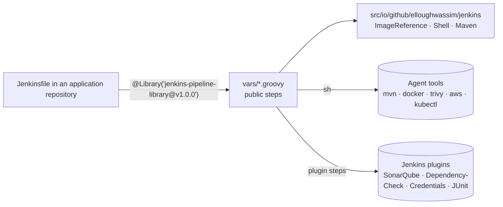

# Jenkins Pipeline Library

A reusable Jenkins Shared Library for Java/Maven and container delivery pipelines. It packages the usual
stages (build, unit and integration tests, SonarQube analysis and Quality Gate, OWASP Dependency-Check,
Trivy scanning, Docker Hub or Amazon ECR publishing, Kubernetes deployment) as small, validated and tested
pipeline steps.

## Table of Contents

- [Project Overview](#project-overview)
- [Key Features](#key-features)
- [Architecture Overview](#architecture-overview)
- [Technology Stack](#technology-stack)
- [Project Structure](#project-structure)
- [Prerequisites](#prerequisites)
- [Installation and Configuration](#installation-and-configuration)
- [Step Reference](#step-reference)
- [Usage](#usage)
- [Testing and Validation](#testing-and-validation)
- [CI/CD Pipeline](#cicd-pipeline)
- [Security Implementation](#security-implementation)
- [License](#license)
- [Author](#author)

## Project Overview

Pipelines often duplicate the same shell snippets from one project to the next. This library moves those
stages into versioned steps, so a `Jenkinsfile` describes *what* happens and the library decides *how*:

```groovy
@Library('jenkins-pipeline-library@v1.0.0') _

stage('Quality gate') { steps { sonarQubeQualityGate() } }
stage('Image scan')   { steps { trivyScan(type: 'image', target: image.primaryReference) } }
```

The current release is **`v1.0.0`** (see `CHANGELOG.md`).

## Key Features

- **One image model for two registries.** Docker Hub and Amazon ECR are selected with a single `registry` key.
- **Immutable image tags.** `imageTags()` returns `<BUILD_NUMBER>-<short git sha>` first, with optional extra
  tags (`latest` by default).
- **Blocking security gates.** `trivyScan` and `sonarQubeQualityGate` fail the build by default. Report-only
  mode must be requested explicitly. Trivy and Dependency-Check reports are always archived.
- **Input validation.** Image names, tags, AWS account IDs, regions, Maven goals, profiles and paths are
  checked against strict patterns before they reach `sh`. Free-form values are single-quoted.
- **Safe registry login.** Passwords are piped through `--password-stdin` inside single-quoted `sh` strings,
  so Groovy never interpolates them.
- **Reproducible Maven.** Batch mode, no download progress, automatic use of `./mvnw` when it exists.
- **Deployment with rollback.** `kubernetesDeploy` renders the image into a temporary copy of the manifests,
  waits for the rollout and runs `kubectl rollout undo` if it fails.

## Architecture Overview



- `vars/` contains the public steps (the library API).
- `src/` contains plain Groovy helper classes holding the validation logic. They can be tested without Jenkins.

## Technology Stack

| Area | Tools |
|---|---|
| Language | Groovy (Jenkins Pipeline) |
| Build and tests | Maven, Maven Wrapper, Surefire / Failsafe reports via JUnit |
| Code quality | SonarQube (Maven scanner or SonarScanner CLI) |
| Security | OWASP Dependency-Check, Trivy |
| Containers | Docker, Docker Hub, Amazon ECR (AWS CLI v2) |
| Deployment | Kubernetes (`kubectl`) |
| Library CI | GitHub Actions, CodeNarc (`npm-groovy-lint`), Gitleaks |

## Project Structure

```text
.
├── vars/                              # Public pipeline steps
│   ├── gitCheckout.groovy
│   ├── mavenBuild.groovy  mavenUnitTest.groovy  mavenIntegrationTest.groovy
│   ├── sonarQubeAnalysis.groovy  sonarQubeQualityGate.groovy
│   ├── owaspDependencyCheck.groovy  trivyScan.groovy
│   ├── imageTags.groovy  dockerBuild.groovy  dockerPush.groovy  dockerCleanup.groovy
│   └── kubernetesDeploy.groovy
├── src/io/github/elloughwassim/jenkins/
│   ├── ImageReference.groovy          # Docker Hub / ECR reference and validation
│   ├── Maven.groovy                   # Maven command builder
│   └── Shell.groovy                   # Quoting and input validation
├── test/run-tests.groovy              # Self-contained test suite (mocked pipeline context)
├── examples/Jenkinsfile.maven-docker-k8s
├── .github/workflows/ci.yml           # Lint, tests, secret scan
├── .groovylintrc.json
├── CHANGELOG.md
└── LICENSE
```

## Prerequisites

| Component | Requirement |
|---|---|
| Jenkins plugins (core) | Pipeline, Git, Credentials Binding |
| Jenkins plugins (per step) | JUnit (`mavenUnitTest`, `mavenIntegrationTest`), SonarQube Scanner (`sonarQubeAnalysis`, `sonarQubeQualityGate`), OWASP Dependency-Check (`owaspDependencyCheck`), AWS Credentials / Pipeline: AWS Steps (`dockerPush` to ECR with `awsCredentialsId`) |
| Agent tools | `git`, `docker`, `trivy`, and depending on the steps used: JDK + Maven (or a Maven Wrapper in the project), AWS CLI v2, `kubectl` |

## Installation and Configuration

### Register the library in Jenkins

1. Open **Manage Jenkins → System → Global Trusted Pipeline Libraries → Add**.
2. Name: `jenkins-pipeline-library`.
3. Default version: `v1.0.0` (pin a tag rather than `main` for reproducible builds).
4. Retrieval method: **Modern SCM → Git**, project repository:

   ```text
   https://github.com/ElloughWassim/jenkins-pipeline-library.git
   ```

   If the repository is private, select a Jenkins credential that can read it.

Register it as a **trusted** global library: the helper classes use standard Groovy methods that a sandboxed
folder-level library may need script approvals for.

### Jenkins credentials used by the steps

| Credential ID (configurable) | Kind | Used by |
|---|---|---|
| `dockerhub-credentials` | Username with password (password = Docker Hub access token) | `dockerPush` (Docker Hub) |
| `aws-credentials` | AWS Credentials (optional when the agent has an instance or IRSA role) | `dockerPush` (ECR) |
| `kubeconfig` | Secret file | `kubernetesDeploy` (optional, otherwise the agent's kubeconfig is used) |
| `nvd-api-key` | Secret text | `owaspDependencyCheck` |
| SonarQube token | Secret text, referenced by the SonarQube server configuration or `credentialsId` | `sonarQubeAnalysis`, `sonarQubeQualityGate` |

`sonarQubeQualityGate` also requires a SonarQube webhook pointing to `<JENKINS_URL>/sonarqube-webhook/`.

### Image configuration map

```groovy
// Docker Hub
[registry: 'dockerhub', namespace: '<DOCKERHUB_NAMESPACE>', name: 'my-app', tags: imageTags()]

// Amazon ECR
[registry: 'ecr', awsAccountId: '<AWS_ACCOUNT_ID>', awsRegion: '<AWS_REGION>', name: 'my-app', tags: imageTags()]
```

Unreplaced placeholders such as `<AWS_ACCOUNT_ID>` fail validation and stop the build.

## Step Reference

`*` = required.

| Step | Purpose | Options (defaults) |
|---|---|---|
| `gitCheckout` | Clone a repository | `url`*, `branch` (`main`), `credentialsId` |
| `mavenBuild` | Package | `goals` (`clean package`), `skipTests` (`true`), `profiles`, `properties` |
| `mavenUnitTest` | `test` phase and Surefire report | `profiles`, `properties`, `publishReports` (`true`) |
| `mavenIntegrationTest` | `verify` phase (Failsafe) and report | `skipUnitTestsProperty` (`skipUTs`, `null` runs all tests), `profiles`, `properties`, `publishReports` (`true`) |
| `sonarQubeAnalysis` | SonarQube scan inside `withSonarQubeEnv` | `installationName`*, `projectKey`, `projectName`, `properties`, `credentialsId`, `scanner` (`maven` \| `cli`), `scannerTool` (`sonar-scanner`) |
| `sonarQubeQualityGate` | Wait for the Quality Gate | `timeoutMinutes` (`10`), `abortPipeline` (`true`), `credentialsId` |
| `owaspDependencyCheck` | Dependency CVE scan and report publishing | `odcInstallation`*, `failOnCvss` (`7`), `nvdApiKeyCredentialsId`, `scanPath` (`.`), `reportDir` (`reports/dependency-check`), `extraArguments` |
| `trivyScan` | Vulnerability, secret and misconfiguration scan | `type` (`fs` \| `image` \| `config` \| `repo`), `target`*, `severity` (`HIGH,CRITICAL`), `failBuild` (`true`), `ignoreUnfixed` (`true`), `scanners`, `reportDir` (`reports/trivy`), `reportName` |
| `imageTags` | Build the tag list | `version`, `extraTags` (`['latest']`) |
| `dockerBuild` | Build and tag the image | `image`*, `context` (`.`), `dockerfile` (`Dockerfile`), `buildArgs` (a `null` value is read from the environment) |
| `dockerPush` | Login, push every tag, logout | `image`*, `credentialsId` (Docker Hub), `awsCredentialsId` (ECR) |
| `dockerCleanup` | Remove local tags, never fails the build | `image`* |
| `kubernetesDeploy` | Render image, apply, wait for rollout, roll back on failure | `manifests`*, `namespace`*, `deployment`*, `image`*, `imagePlaceholder` (`IMAGE_PLACEHOLDER`), `rolloutTimeout` (`180s`), `kubeconfigCredentialsId` |

Options are meant to come from the `Jenkinsfile` (trusted code). Values coming from build parameters are
validated before use.

## Usage

`examples/Jenkinsfile.maven-docker-k8s` contains a complete declarative pipeline:

```text
Unit tests → Integration tests → SonarQube analysis → Quality gate → Package → Trivy fs
  → Docker build → Trivy image → Push (Docker Hub | ECR) → Deploy to Kubernetes (optional)
```

The library is used by the `springboot-terraform-eks`, `jpetstore-kubernetes-deployment` and
`devsecops-jenkins-trivy-sonarqube` projects, which all pin `v1.0.0`.

## Testing and Validation

The test suite needs a Java runtime and Groovy 4. Without a local Groovy installation, reuse the runtime
bundled with `npm-groovy-lint`, as CI does (CI uses Java 21 and Node.js 22):

```bash
npm install --global npm-groovy-lint@19
GROOVY_LIB="$(npm root --global)/npm-groovy-lint/lib/java/groovy/lib"

# Tests
java -cp "$GROOVY_LIB/*" groovy.ui.GroovyMain test/run-tests.groovy

# Lint (CodeNarc)
npm-groovy-lint --path . --files '**/{*.groovy,Jenkinsfile*}' --failon error
```

`test/run-tests.groovy` loads each of the 13 steps with a mocked pipeline context (`sh`, `withCredentials`,
`error`, …) and asserts on the generated commands, including failure paths such as Trivy findings, failed
rollouts and invalid input. It does **not** start Jenkins: a full integration run still requires a real
Jenkins controller.

## CI/CD Pipeline

`.github/workflows/ci.yml` runs on pushes to `main` and on pull requests:

| Job | What it does |
|---|---|
| Unit tests and lint | CodeNarc lint with `npm-groovy-lint` (fails on errors), then the test suite |
| Secret scan | Gitleaks over the full Git history |

Releases are Git tags (`vX.Y.Z`). Consumers pin a tag in `@Library`.

## Security Implementation

- Docker Hub passwords and tokens go through `--password-stdin` inside single-quoted `sh` strings: the shell
  expands the secret, Groovy never interpolates it.
- ECR login uses `aws ecr get-login-password | docker login --password-stdin`.
- All values placed in shell commands are validated or single-quoted.
- Trivy and the SonarQube Quality Gate fail the build by default.
- Docker build arguments are visible in the image history. Pass sensitive values with a `null` value (read
  from the environment, never written on the command line), and never use build arguments for server-side
  secrets.
- Prefer short-lived cloud credentials (instance roles, IRSA, OIDC) over static AWS keys.

## License

This project is licensed under the MIT License. See [`LICENSE`](LICENSE).

Copyright (c) 2026 ElloughWassim.

## Author

**ElloughWassim** · [github.com/ElloughWassim](https://github.com/ElloughWassim)
